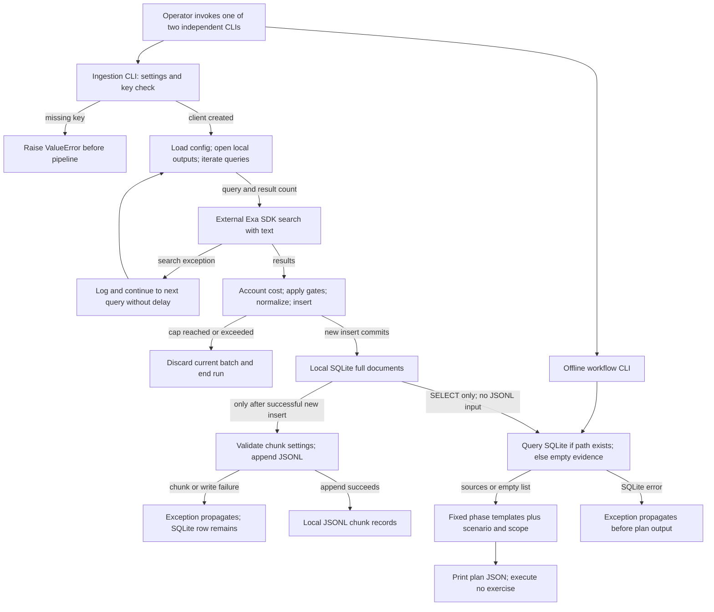

# System Architecture

> Category: Architecture | Version: 1.0 | Date: October 2026 | Status: Active

Maintainers can use this reference to trace the Python command-line application from external corpus collection to offline exercise-plan output.

**Related:**
- [Corpus storage](../data/corpus-storage.md)
- [Operations runbook](../operations/runbook.md)
- [Package and entry-point declarations](../../../../pyproject.toml)

---

## Why this exists

The application collects cybersecurity reference material and attaches local citations to fixed exercise plans; it does not execute the exercises.
The two independent commands separate a potentially billable external search from local plan generation.
This is an explanation of inspected implementation, not a deployment description or an authorization mechanism (`pyproject.toml:24-26`; `src/sec_redteam/workflows/cli.py:23-38`).

**Source baseline:** HEAD `1e71d28b23881f5d1c76849003cd144cfe545947`; inspected on **2026-10-19**.
Application source, tests and `pyproject.toml` had no tracked diff at inspection.
The pre-existing untracked `CLAUDE.md:4-25` describes the same operational traps; it is context, not part of that commit.
No ADRs, PRDs or roadmap were present in the initial Library survey, so this reference does not invent decision rationale or accepted requirements.

## Entry points and responsibilities

The package requires Python 3.11 or later and uses a setuptools `src/` layout (`pyproject.toml:1-17,28-32`).
Both installed commands also have module-entry guards (`src/sec_redteam/ingest/cli.py:91-92`; `src/sec_redteam/workflows/cli.py:41-42`).

| Entry point or component | Responsibility | Source |
|---|---|---|
| `sec-redteam-ingest` → `ingest.cli:main` | Parse options, select preset, construct settings and Exa client | `pyproject.toml:25`; `src/sec_redteam/ingest/cli.py:64-88` |
| `ExaSearchClient` | Load environment, require a key, request search results with text | `src/sec_redteam/ingest/exa_client.py:24-46` |
| `run_ingestion` | Sort queries, account estimated cost, filter, normalize, insert and append chunks | `src/sec_redteam/ingest/pipeline.py:70-181` |
| `init_db` / `insert_doc` | Create SQLite schema and commit individual inserts | `src/sec_redteam/ingest/storage.py:23-75` |
| `sec-redteam-workflow` → `workflows.cli:main` | Retrieve evidence, construct a plan and print JSON | `pyproject.toml:26`; `src/sec_redteam/workflows/cli.py:23-38` |
| `fetch_evidence_sources` | Search full SQLite documents with substring predicates | `src/sec_redteam/workflows/evidence.py:19-61` |
| `build_workflow_plan` | Select fixed red, blue or purple phase lists | `src/sec_redteam/workflows/planner.py:121-172` |

## Component and data boundaries

Ingestion calls Exa before applying the corpus allowlist or budget threshold.
The adapter invokes `load_dotenv()`, takes an explicit key or `EXA_API_KEY`, and raises `ValueError` when neither supplies a key.
The SDK receives the query, requested result count and `text=True`; the local adapter returns title, URL, text and optional publication date (`src/sec_redteam/ingest/exa_client.py:24-46`).
No credentials or collected corpus were read for this documentation.

Arrows denote local calls, conditional control flow or named data movement, not queues or deployment tiers.
The SQLite-to-export arrow means ordering after a committed insert; it does **not** mean the exporter reads SQLite.
The overview collapses per-result rejection, ordinary sleep and loop exhaustion; the storage reference expands those branches.
Configuration, output-opening and non-search processing errors propagate; only the search-call block catches general exceptions (`src/sec_redteam/ingest/pipeline.py:70-100,113-181`).
No application queue, scanner invocation, LLM generation call or execution authorization gate occurs on these inspected CLI paths.
SDK retry, transport and billing behavior remain outside this source inspection.

## Ingestion semantics that affect architecture

SQLite and JSONL are two outputs, not replicas with a shared transaction.
Each accepted document commits to SQLite before chunk validation and JSONL writing.
Duplicate inserts skip JSONL, so rerunning against the same database is not an export-repair operation (`src/sec_redteam/ingest/storage.py:49-75`; `src/sec_redteam/ingest/pipeline.py:141-161`).

Selection is first-writer-wins rather than refresh/upsert.
Sorted topics and queries establish traversal order, but results retain provider order.
URLs enter a run-local seen set before minimum-length rejection; SQLite additionally constrains URL-derived IDs and normalized-content hashes (`src/sec_redteam/ingest/pipeline.py:80-142`).
The result count increases estimated spend before any filtering, and the threshold-reaching batch is discarded (`src/sec_redteam/ingest/pipeline.py:100-111`).

## Offline evidence and fixed plans

The workflow command reads SQLite, never the JSONL chunks.
A nonexistent database path returns an empty source list; an existing incompatible database raises a query error instead of quietly becoming an empty corpus (`src/sec_redteam/workflows/evidence.py:19-48`).
The helper extracts up to eight distinct lowercased alphanumeric tokens of at least four characters from the scenario, falling back to the workflow type if none qualify.
It ORs parameterized `%keyword%` matches across `title`, `text` and `topic`, then orders by `rowid DESC`, not relevance or publication date.
Each citation includes title, URL, domain, topic and the first 280 text characters, not a match-centered excerpt (`src/sec_redteam/workflows/evidence.py:10-61`).

The planner only interpolates the scenario into prewritten text, selects assumptions and scorecard labels, and attaches evidence unchanged.
It strips the scenario and substitutes `adversary simulation` when blank; evidence lookup happens earlier using the original scenario (`src/sec_redteam/workflows/cli.py:24-37`; `src/sec_redteam/workflows/planner.py:121-172`).

| Type | Fixed phases | Source |
|---|---|---|
| Red | Plan; Emulate; Validate Detection; Recovery & Lessons | `src/sec_redteam/workflows/planner.py:6-48` |
| Blue | Telemetry Readiness; Detection Engineering; Incident Drill | `src/sec_redteam/workflows/planner.py:51-83` |
| Purple | Joint Planning; Live Exercise; Hardening Sprint | `src/sec_redteam/workflows/planner.py:86-118` |

`--scope` is an output field, not an enforced execution boundary.
Statements such as “Authorized environment and explicit permission are in place” are static assumptions, not approval evidence.
Action and scorecard strings do not execute commands or calculate metrics (`src/sec_redteam/workflows/models.py:9-34`; `src/sec_redteam/workflows/planner.py:121-172`).

## Diagram evidence ledger

The following exact working-file SHA-256 hashes pin the diagrams in this document and its two related domain references.
Paths in this table are relative to `src/sec_redteam/`.

| File | SHA-256 |
|---|---|
| `ingest/cli.py` | `03ee3d1229936d89be6759ef820745ab42b5c2be2df01e8ddd68020d9e0f3ea0` |
| `ingest/exa_client.py` | `4f26d6ab53e7222029a9f174942d43751ecb0cab4a7d975da636fe7a5cfa9b37` |
| `ingest/pipeline.py` | `21316991acfc59f27394009273c1d0d098a46b3287438e08f4449c982dcf3d36` |
| `ingest/storage.py` | `089fcf6347746f6a38459ee1d2cc592f1c04ce0ad1e4dcbc0b299f2225abff40` |
| `ingest/utils.py` | `6ea669b603c19a64aa39d6c776f9489024c7718c46bc5835d85c90c2b7a3c1f2` |
| `workflows/cli.py` | `50a9bb2db071634f8dcb3a755982dc9829f0dabf48639b24e6762255303d83a3` |
| `workflows/evidence.py` | `0417de6ba76a14117429730d895a1f3ae48245a1d99395f04c081e881f45506f` |
| `workflows/planner.py` | `a9731ee7d69d26a945600466415a5575f3da6cce1dabe0df55e64642fe5d8486` |

| Edge or branch | Symbol, source and exact short quote | Meaning |
|---|---|---|
| CLI → provider | `ExaSearchClient.search_and_contents`, `src/sec_redteam/ingest/exa_client.py:33`: `text=True` | External search precedes local gates |
| Search failure → next query | `run_ingestion`, `src/sec_redteam/ingest/pipeline.py:96-98`: `continue` | No application retry or sleep on this branch |
| Results → stop | `run_ingestion`, `src/sec_redteam/ingest/pipeline.py:100-111`: `estimated_spend_usd >= settings.budget_usd` | Entire current batch is skipped |
| Insert → commit → export | `insert_doc`, `src/sec_redteam/ingest/storage.py:72`: `conn.commit()`; `run_ingestion`, `src/sec_redteam/ingest/pipeline.py:154-160`: `chunks=chunk_text(` | Separate durability boundaries |
| Missing corpus → empty sources | `fetch_evidence_sources`, `src/sec_redteam/workflows/evidence.py:20-21`: `return []` | No provider fallback |
| Evidence → plan | `build_workflow_plan`, `src/sec_redteam/workflows/planner.py:171`: `evidence_sources=evidence_sources or []` | Citations do not select phases |

## Verification and limits

Source walkthroughs checked the successful insert/export path, URL/domain/length rejection, duplicate insert, budget stop, search failure and post-commit export failure.
Workflow walkthroughs checked missing-corpus early return and query-error propagation before output.
These are semantic source checks, not observed production executions.

On 2026-10-19, the existing 18 tests passed under Python 3.12 with Python socket connections blocked, bytecode writing disabled and pytest cache disabled.
The tests use synthetic inputs; they do not establish live provider behavior or existing corpus health (`tests/test_pipeline.py:19-94`; `tests/test_workflows.py:4-21`).
No Mermaid parser/render was run: `mmdc` was not available on PATH, and no renderer or dependency was installed.
No collected data, secrets, live ingestion, scanner or LLM execution formed part of this refresh.
