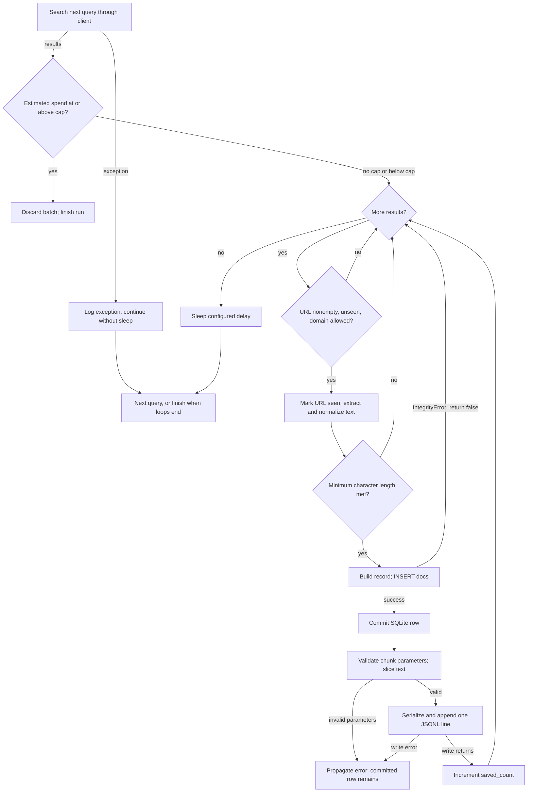

# Corpus Storage

> Category: Data | Version: 1.0 | Date: October 2026 | Status: Active

Maintainers can use this reference to understand the corpus schema, ingestion selection rules and independent SQLite/JSONL failure boundaries.

**Related:**
- [System architecture and source hashes](../architecture/system-overview.md)
- [Operations runbook](../operations/runbook.md)
- [Storage implementation](../../../../src/sec_redteam/ingest/storage.py)

---

## Why this exists

SQLite stores full normalized documents for evidence lookup; JSONL stores character chunks only for newly inserted documents.
These outputs serve different consumers and do not share an atomic commit.
The workflow reader queries `docs`, not JSONL (`src/sec_redteam/ingest/pipeline.py:127-161`; `src/sec_redteam/workflows/evidence.py:35-46`).

**Source baseline:** HEAD `1e71d28b23881f5d1c76849003cd144cfe545947`, inspected **2026-10-19**; source hashes are in the related architecture ledger.
This documents source behavior, not the contents or integrity of any existing database; no collected data was inspected.

## Complete SQLite schema

`init_db` creates parent directories, opens a normal SQLite connection, creates the table and two explicit indexes, then commits.
It does not implement migrations, schema-version tracking or repair of an incompatible existing table (`src/sec_redteam/ingest/storage.py:23-46`).

```sql
CREATE TABLE IF NOT EXISTS docs (
  id TEXT PRIMARY KEY,
  topic TEXT,
  query TEXT,
  title TEXT,
  url TEXT,
  domain TEXT,
  published_at TEXT,
  fetched_at TEXT,
  text_len INTEGER,
  text TEXT,
  sha256 TEXT UNIQUE
);
CREATE INDEX IF NOT EXISTS idx_domain ON docs(domain);
CREATE INDEX IF NOT EXISTS idx_topic ON docs(topic);
```

This is the entire application-created schema at the pinned revision, including every declared column, constraint and explicit index (`src/sec_redteam/ingest/storage.py:28-44`).
SQLite manages the primary-key and uniqueness indexes; the application declares no foreign keys, full-text index, `NOT NULL` constraints or URL uniqueness constraint.
The table is not declared `STRICT` or `WITHOUT ROWID`.
The evidence reader relies on its implicit `rowid` (`src/sec_redteam/workflows/evidence.py:35-40`).

| Field | Writer semantics |
|---|---|
| `id` | First 24 hexadecimal characters of SHA-256 over the exact result URL |
| `topic`, `query` | First successful ingestion context; no many-to-many attribution |
| `title`, `url` | Provider values; no URL canonicalization in the pipeline |
| `domain` | Registrable-domain extraction, not exact hostname |
| `published_at` | Optional provider publication-date value; no parsing here |
| `fetched_at` | UTC ISO-formatted timestamp created locally for an accepted candidate |
| `text_len`, `text` | Python character count and normalized full text |
| `sha256` | Full SHA-256 hex digest of normalized text, globally unique in `docs` |

Field construction comes from `src/sec_redteam/ingest/pipeline.py:124-139`; hashing and normalization come from `src/sec_redteam/ingest/utils.py:10-22`.
`DocumentRecord` annotates these values but the database schema itself permits nullable columns (`src/sec_redteam/ingest/storage.py:8-20,28-40`).

## Selection order and first-writer-wins behavior

Topics and queries run in lexical order; provider results stay in their returned order.
The config loader converts topic names and query elements to strings but does not validate a richer schema (`src/sec_redteam/ingest/pipeline.py:54-61,80-86`; `src/sec_redteam/ingest/utils.py:44-45`).

The pipeline rejects empty URLs and URLs already seen in the current run, then applies the domain filter.
An empty allowed-domain set permits all URLs when calling the pipeline directly.
Otherwise `domain_of(url)` must equal an entry in that set (`src/sec_redteam/ingest/pipeline.py:64-67,113-118`).
The CLI replaces the default allowlist when any `--allow-domain` is supplied; it does not extend it.
Because extraction returns registrable domains, default entries `cloud.google.com`, `learn.microsoft.com` and `aws.amazon.com` do not match those hosts as written (`src/sec_redteam/ingest/cli.py:12-24,72`; `src/sec_redteam/ingest/utils.py:10-13`).
This is a corpus filter after external search, not an authorized scanning-target boundary.

A domain-approved URL enters `seen_urls` before text extraction and minimum-length validation.
Consequently, a short first result suppresses a later usable result with the same URL during that run.
Text that resembles HTML goes through `trafilatura.extract` without comments or tables; unsuccessful extraction falls back to the raw text.
Plain text passes through unchanged before normalization replaces NULs with spaces, collapses whitespace and strips ends (`src/sec_redteam/ingest/pipeline.py:35-51,118-122`; `src/sec_redteam/ingest/utils.py:16-18`).

`insert_doc` uses a plain parameterized `INSERT`, commits each success and returns `False` on any `sqlite3.IntegrityError`.
It does not update existing rows (`src/sec_redteam/ingest/storage.py:49-75`).
Thus changed text at an existing URL does not refresh the row, and identical normalized text at another URL or topic does not acquire another attribution.
A primary-key hash collision would also reject an insert; the code does not distinguish collision, repeat URL and repeat content.
The helper does not explicitly roll back the caught integrity-error path, and the pipeline does not explicitly close its SQLite connection (`src/sec_redteam/ingest/storage.py:49-75`; `src/sec_redteam/ingest/pipeline.py:70-181`).

## Estimated budget is checked after fetching

Every returned result contributes to estimated spend before domain, length or duplicate checks.
For each successful search the calculation is `len(results) * estimated_cost_per_result_usd`, accumulated for this run.
At `estimated_spend_usd >= budget_usd`, the pipeline discards the entire current batch and exits the query/topic loops (`src/sec_redteam/ingest/pipeline.py:100-111,168-169`).
Even a zero cap does not prevent the first external search.
This is not actual provider billing, a preflight reservation or a hard spending limit.

The default estimated rate is `$0.002` per result, but the CLI accepts a caller-supplied float without range validation (`src/sec_redteam/ingest/cli.py:48-54,84-85`).
The existing budget test proves one saved document for its fixture, not independently the absence of later searches or correctness of provider accounting (`tests/test_pipeline.py:75-94`).

## Ordered write and failure paths

The decisive boundary is the SQLite commit before chunk creation, not the final ingestion log message.
The following flow expands one query's handling; its “next query” node represents the enclosing sorted loops and eventual exhaustion.



Arrows represent synchronous control flow, not a transactional grouping.
Other failures in config loading, output opening, extraction, SQL, sleep or file close also propagate; the diagram concentrates on result selection and the post-commit export gap (`src/sec_redteam/ingest/pipeline.py:70-181`).
`insert_doc`'s `conn.commit()` at `src/sec_redteam/ingest/storage.py:72` precedes `chunks=chunk_text(...)` and `output.write(...)` at `src/sec_redteam/ingest/pipeline.py:154-160`.
Those exact statements and the architecture hash ledger anchor the commit/export edges.

## JSONL record and character chunking

Each appended line represents one document with a `chunks` array, not one line per chunk.
The complete JSON object has `id`, `topic`, `query`, `title`, `url`, `domain`, `published_at`, `fetched_at`, `text_len` and `chunks`.
It omits full `text` and `sha256`; serialization uses `ensure_ascii=False` (`src/sec_redteam/ingest/pipeline.py:21-32,144-160`).
No embedding or tokenization step exists in this path.

Chunks slice Python strings by character position with step `chunk_size - chunk_overlap`.
Validation requires `chunk_size > 0`, `chunk_overlap >= 0` and `chunk_overlap < chunk_size`.
The loop continues while its start is less than the text length, so an overlap-only trailing chunk is possible.
For example, size 4 and overlap 1 turn `abcdefghij` into `abcd`, `defg`, `ghij`, `j` (`src/sec_redteam/ingest/utils.py:25-41`; `tests/test_utils.py:12-14`).
CLI defaults are size 1400 and overlap 200 (`src/sec_redteam/ingest/cli.py:46-47`).

JSONL opens in append mode before the query loops and writes only after a new database insert.
It has no deduplication of its own, no fsync protocol and no cross-file transaction.
A buffered write returning is not a durable export acknowledgment (`src/sec_redteam/ingest/pipeline.py:80,141-161`).
Changing the output path or chunk parameters with the same database does not regenerate already stored documents.
Conversely, using a new database with an existing JSONL file can append duplicate document records.

## Reader contract and recovery implications

Evidence retrieval sees committed SQLite documents even if their JSONL append failed.
It matches scenario keywords against full text, title and topic, returns up to the requested limit in descending `rowid` order and selects the first 280 text characters as an excerpt (`src/sec_redteam/workflows/evidence.py:19-61`).
This insertion-oriented ordering is neither relevance ranking nor sorting on `fetched_at`.

A rerun cannot repair missing JSONL for rows that now conflict at insertion.
Preserve both outputs and treat reconciliation or a separate export-from-SQLite utility as explicitly scoped follow-up work, not an existing command.
Do not delete the database to force regeneration without a recovery plan and approval.
The related runbook separates diagnostics from destructive recovery.

## Checks and unresolved evidence

Source walkthroughs followed normal insertion, invalid URL/domain/length rejection, duplicate suppression, post-fetch budget stop and post-commit chunk/write failure.
The schema above mirrors the only DDL in `src/sec_redteam/ingest/storage.py:28-44`.
The existing 18-test suite passed with socket connections blocked on 2026-10-19; existing tests cover basic output, extraction detection, presets, chunk overlap and planner shape, not all failure branches.
No live corpus inspection or fault injection established actual stored-state consistency.
Mermaid received source-semantic review only; no parser or renderer was run.
