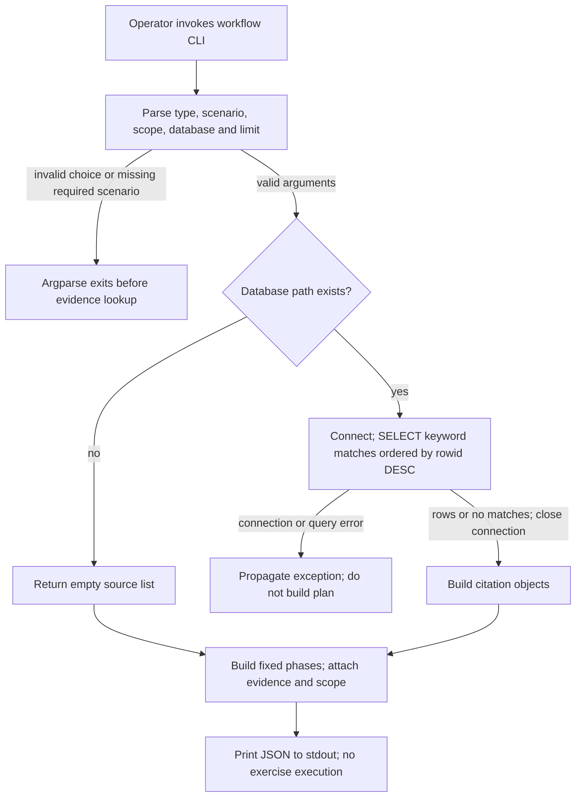

# Local Corpus and Plan Operations

> Category: Operations | Version: 1.0 | Date: October 2026 | Status: Active

Operators can use this runbook to distinguish external ingestion from offline planning and diagnose incomplete outputs without assuming that reruns repair them.

**Related:**
- [System architecture and source hashes](../architecture/system-overview.md)
- [Corpus storage](../data/corpus-storage.md)
- [Command declarations and dependencies](../../../../pyproject.toml)

---

## Why this exists

A normal CLI exit does not establish complete collection, synchronized outputs or a validated exercise plan.
Search failures are logged and skipped, while missing workflow databases silently produce plans without citations (`src/sec_redteam/ingest/pipeline.py:85-98,171-181`; `src/sec_redteam/workflows/evidence.py:19-21`).
This runbook documents those operational distinctions without running ingestion or changing the application.

**Source baseline:** HEAD `1e71d28b23881f5d1c76849003cd144cfe545947`, refreshed **2026-10-19**.
The architecture reference pins diagram source hashes; `CLAUDE.md:11-25` supplies additional current-checkout context.
No production environment, corpus health, provider entitlement or deployment state was verified.

## Choose the correct boundary

Use ingestion only when external Exa requests and their potential cost are authorized.
`sec-redteam-ingest` constructs an `ExaSearchClient`, which loads environment values through `load_dotenv()`, requires an explicit key or `EXA_API_KEY`, and requests search contents (`src/sec_redteam/ingest/cli.py:88`; `src/sec_redteam/ingest/exa_client.py:24-33`).
Do not paste secrets into documentation, command transcripts or issue reports.
The pipeline has no dry-run CLI option and its budget is a post-fetch estimate, not provider-side enforcement (`src/sec_redteam/ingest/cli.py:27-61`; `src/sec_redteam/ingest/pipeline.py:100-111`).

Use `sec-redteam-workflow` to read local SQLite evidence and print a plan without calling Exa.
The workflow imports the local evidence/model/planner modules and performs no external search or LLM generation (`src/sec_redteam/workflows/cli.py:8-10,23-38`).
The generated “actions,” permission assumptions and scope are text for human review, not executed scans, approval records or enforcement (`src/sec_redteam/workflows/planner.py:6-172`).

## Resolve paths before invoking a command

Run from the repository root unless you supply explicit paths.
Both commands default to `data/cyber_corpus.db`; ingestion additionally defaults to `data/cyber_docs.jsonl`.
Preset query paths point into `src/sec_redteam/ingest/` relative to the current working directory, not relative to the installed package (`src/sec_redteam/ingest/cli.py:41-42,75-77`; `src/sec_redteam/ingest/presets.py:15-63`; `src/sec_redteam/workflows/cli.py:18`).
When operating elsewhere, provide ingestion `--config`, `--db` and `--jsonl`, then pass that same `--db` to the workflow command.
A custom config supplies the topic-to-query-list JSON; other preset settings still apply (`src/sec_redteam/ingest/cli.py:74-85`; `src/sec_redteam/ingest/pipeline.py:54-61`).

The following is an **example only**, not a command executed for this refresh.
It assumes an already available CLI and an operator-approved local corpus path:

```bash
sec-redteam-workflow --type blue \
  --scenario "cloud identity abuse" \
  --scope lab \
  --db /absolute/path/to/cyber_corpus.db \
  --evidence-limit 10
```

Plan JSON goes to stdout; there is no workflow output-file flag (`src/sec_redteam/workflows/cli.py:13-38`).
Verify the chosen corpus exists before relying on citations: a typo that names a nonexistent path produces an empty evidence list rather than an error.
An existing empty or incompatible SQLite file instead raises a query error (`src/sec_redteam/workflows/evidence.py:19-48`).

## Preflight settings without assuming guarantees

Review settings before an authorized ingestion run, because several options behave differently from their names or help text.
These checks are operator recommendations, not new validation implemented by this documentation.

| Setting | Actual behavior and operator implication | Source |
|---|---|---|
| `--allow-domain` | Replaces defaults; entries must match registrable domains, not provider subdomains | `src/sec_redteam/ingest/cli.py:56-59,72`; `src/sec_redteam/ingest/utils.py:10-13` |
| `--sleep-between-calls 0` | Falls back to preset delay; max-results and min-length zero overrides also fall back because they use `or` | `src/sec_redteam/ingest/cli.py:78-80` |
| Chunk size/overlap | Require positive size and `0 <= overlap < size`; validation happens after insertion | `src/sec_redteam/ingest/utils.py:25-31`; `src/sec_redteam/ingest/pipeline.py:141-158` |
| Budget and estimated rate | Count every returned result, then discard the threshold-reaching batch; no numeric range checks here | `src/sec_redteam/ingest/cli.py:48-54`; `src/sec_redteam/ingest/pipeline.py:100-111` |
| Evidence limit | CLI accepts any integer; zero yields no rows and a negative SQLite LIMIT removes the cap | `src/sec_redteam/workflows/cli.py:19`; `src/sec_redteam/workflows/evidence.py:35-46` |

The default preset asks for 50 results per query, minimum text length 1200 and a 0.7-second delay (`src/sec_redteam/ingest/presets.py:16-21`).
A direct caller constructing `IngestionSettings` can pass zero delay successfully; the zero-override trap belongs to the CLI, not the dataclass or pipeline (`src/sec_redteam/ingest/types.py:7-19`; `tests/test_pipeline.py:52-66`).
Negative or otherwise invalid settings are not comprehensively rejected before external work.

## Workflow diagnostic journey

The offline command either prints a template plan with optional evidence or propagates a local read error.
It does not fetch missing evidence from the network.



Arrows show synchronous control flow, not permission or delivery guarantees.
The source anchors are `build_parser` at `src/sec_redteam/workflows/cli.py:13-20`, `fetch_evidence_sources` at `src/sec_redteam/workflows/evidence.py:19-61` and `main` at `src/sec_redteam/workflows/cli.py:23-38`.
The exact early-return statement is `return []` at `src/sec_redteam/workflows/evidence.py:21`; the output statement is `print(json.dumps(asdict(plan), indent=2))` at `src/sec_redteam/workflows/cli.py:38`.
The query connection closes in `finally`; a connection-opening failure occurs before that block (`src/sec_redteam/workflows/evidence.py:44-48`).
Serialization/stdout failures can still propagate; the diagram is bounded to argument parsing, evidence lookup and plan construction.

## Diagnose ingestion without destructive retries

Start from the exception or symptom, not from deleting files or repeating external searches.
The application retries no failed query explicitly; failed searches skip the normal sleep and proceed to the next query (`src/sec_redteam/ingest/pipeline.py:85-98,166`).
SDK-internal retries and provider charges were not inspected.

| Symptom | Source-grounded explanation | Safe next investigation |
|---|---|---|
| Missing-key exception | Client initialization precedes the pipeline | Check secret provisioning without printing values; do not assume a run occurred |
| `exa_search_failed`, possibly normal exit | Search exception is logged and swallowed; all searches can fail without a nonzero exit | Review failure logs and provider access before authorizing another run |
| `budget_cap_reached` with fewer documents | Cost counts results before filtering and discards the entire threshold-reaching batch | Compare requested budget/rate to intended collection; do not interpret the estimate as an invoice |
| Empty or sparse outputs | Domain mismatch, length rejection, seen URLs and SQLite conflicts all skip records | Inspect configuration and metadata only under approved corpus-access scope |
| Row exists but JSONL lacks it | SQLite committed before chunk validation or append failed | Preserve outputs; scope reconciliation separately instead of rerunning blindly |
| New JSONL path stays empty | Existing database rows fail insert, so export is skipped | Recognize that there is no export-only/rebuild command |
| Changed page remains stale | URL-derived primary key blocks refresh | Treat update/refresh behavior as a missing feature, not a successful upsert |

These paths follow `src/sec_redteam/ingest/exa_client.py:25-30`, `src/sec_redteam/ingest/pipeline.py:100-169` and `src/sec_redteam/ingest/storage.py:49-75`.
Failures in extraction, database operations other than caught integrity errors, chunking, output writing and sleep escape the pipeline.
The JSONL file context closes on exit, but the SQLite connection has no explicit close or recovery wrapper (`src/sec_redteam/ingest/pipeline.py:70-181`).

The default log format prints timestamp, level, logger name and message, not the `extra` fields such as `saved_count`, query or estimated spend.
Those fields exist on log records but are not visible merely because the source passes them to the logger (`src/sec_redteam/ingest/cli.py:65-68`; `src/sec_redteam/ingest/pipeline.py:87-94,171-179`).
`main` ignores the pipeline's returned count, so an exit code alone is not a document-count receipt (`src/sec_redteam/ingest/cli.py:88`; `src/sec_redteam/ingest/pipeline.py:181`).

## Recover with explicit scope

Preserve SQLite and JSONL together before investigating a suspected divergence; do not discard either as an automatic fix.
The code has no cross-file transaction, export replay, migration or repair command.
A rerun skips existing database rows and cannot recreate their missing JSONL chunks (`src/sec_redteam/ingest/pipeline.py:141-160`; `src/sec_redteam/ingest/storage.py:23-75`).
Any backup, reconciliation, restore or new export utility requires a separately approved operational scope; none was performed for this refresh.

For evidence-free plans, distinguish missing path, no keyword matches and a zero evidence limit.
For surprising citations, remember that matching ORs keyword substrings and orders by descending `rowid`, while excerpts always come from the beginning of text (`src/sec_redteam/workflows/evidence.py:10-42`).
Sources neither establish that the template fits the scenario nor alter the phase actions.
Human review must establish real scope, authorization and exercise design outside this CLI (`src/sec_redteam/workflows/planner.py:121-172`).

## Verification receipt and remaining caveats

The documentation refresh read application source, tests, `pyproject.toml` and current `CLAUDE.md` context, without reading secrets or collected data.
On 2026-10-19, all 18 existing tests passed under Python 3.12 using `pytest.main(['-q', '-p', 'no:cacheprovider'])` with bytecode writes disabled and Python socket connection methods blocked.
An installed pytest-asyncio plugin emitted an unset-fixture-loop-scope deprecation warning; no configuration was changed.
This validates the existing synthetic test suite, not live Exa access or corpus consistency.

Source-level diagram walkthroughs checked successful output, argparse rejection, missing-database early return and SQLite error propagation.
No local Mermaid parser/render was available or run; diagrams were not sent to a remote service.
Existing tests do not cover evidence retrieval or SQLite/JSONL recovery (`tests/test_workflows.py:1-21`; `tests/test_pipeline.py:45-94`).

Suspected follow-up issues, not fixes in this refresh, include the subdomain allowlist mismatch, truthy numeric overrides, post-commit chunk validation, lack of refresh/export repair and weak numeric validation.
The adapter also imports `dotenv` directly while `python-dotenv` is absent from the project's explicit dependency list; an existing environment or transitive dependency can mask this packaging risk (`src/sec_redteam/ingest/exa_client.py:7`; `pyproject.toml:12-17`).
No clean-environment install was attempted, so this is not a demonstrated installation failure.
